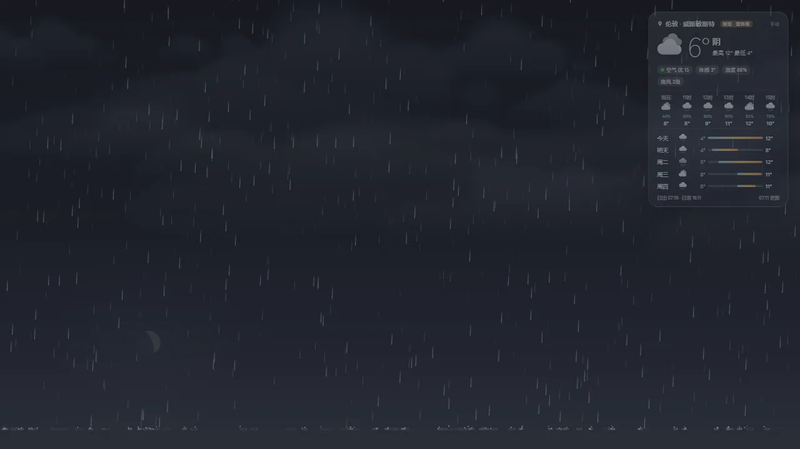

# 天气壁纸 Weather Wallpaper

Windows 11 动态天气桌面：按当前定位和当地时间实时渲染天空和天气，桌面上显示一张半透明天气卡片。下雨时雨点还会砸在任务栏和窗口顶边上。

<p align="center"><br><sub>一天快进演示（48 秒走完日出 → 正午 → 日落 → 夜晚）</sub></p>

## 效果预览

| 晴天 | 多云 |
|:---:|:---:|
|  |  |
| **日落** | **晴夜** |
|  |  |
| **毛毛雨** | **暴雨** |
|  |  |
| **雷阵雨** | **雪** |
|  |  |

<p align="center"><br><sub>天气卡片（100% 缩放下的原尺寸截图）</sub></p>

> 动图按 1280×720 录制（点开可看大图），实际是全屏、按显示器分辨率渲染。所有天气都可以在托盘菜单「效果预览」里随时看。

## 功能

- **天空**：太阳的位置和颜色按当地日出日落实时计算（晨昏的橙红、正午的白亮），夜晚有星空和真实月相：月亮按农历日子东升西落（初三四傍晚西边一弯新月、十五六整夜一轮满月），亮面朝向太阳，细月牙时还能看到暗面的地照。
- **天气**：晴、多云、阴、雾、毛毛雨、中雨、暴雨、雷阵雨（带闪电）、雪。云量、风向、风速都来自实时数据。雨停转晴的白天，背对太阳的一侧会挂出一道彩虹（默认 30 秒，每场雨一次）。
- **极简模式**（默认关）：平时桌面就是你自己的系统壁纸 + 天气卡片，天气画面完全不画；只在值得注意的时候整屏播放一小段天气动画（默认 30 秒，`PlaySeconds` 可调）再淡出——启动时、转雨 / 暴雨 / 雷雨、下雪、雨后转晴（彩虹）。桌面被窗口挡住、锁屏或人不在电脑前时先记下，等桌面露出来、有人操作时再看是否还需要播（雨已经停了就不播了）。
- **天气卡片**：城市、温度、最高/最低、体感、湿度、风力、空气质量（中国 AQI 标准）、逐小时预报和 5 天预报。
  - 位置可选：右上、左上、顶部居中、右下、左下；边距可调。
  - 不想在桌面上放卡片也可以关掉，**左键点托盘图标**随时弹出（类似 Windows 快捷设置面板，点别处自动收起）。
- **任务栏**：下雨时雨点砸在任务栏上沿，溅起水花、留下涟漪；下雪时任务栏上积雪。配色跟随系统深色/浅色主题。
- **窗口屋檐**：大小适中的普通窗口顶边也会被雨打出水花、积起薄雪（最大化和全屏窗口不算）。拖动或最小化窗口时，积雪会被抖掉。
- **多显示器**：可选全部显示器、仅主显示器或某一块显示器。
- **自动更新**：启动后和每 12 小时检查一次新版本。不弹通知打扰，只在托盘右键菜单和左键弹出面板里提示；点一下自动下载并更新（安装版和便携版都支持），完成后自动重启。国内网络优先走加速地址。

## 性能

后台常驻的壁纸程序，最在意的就是占用。实测（Windows 11，16 线程 CPU，1920×1080，默认 30 FPS）：

| 场景 | CPU（占整机） | 内存（私有工作集） |
|---|---|---|
| 晴天 / 多云 / 阴天 | 约 1–3%（0.15–0.45 核） | 约 240 MB |
| 暴雨 + 任务栏 + 窗口屋檐 | 约 5–6%（≈0.9 核） | 约 270 MB |
| 桌面被窗口挡住 / 锁屏 / 全屏游戏或视频 | ≈0（暂停） | 不变 |
| 极简模式（平时） | ≈0（0.01 核，GPU 0%） | 约 200 MB |

CPU 按桌面完全露出时测的；桌面被其它窗口大面积遮挡时会自动降帧，实际更低。

内存里约 **120 MB 是 WebView2（Edge 内核）的固定开销**（浏览器、GPU、网络等进程，空白页也要这么多），程序本体约 20 MB，托盘弹出面板常驻约 15 MB（为了点开即显示），其余是画面渲染。在意占用就开**极简模式**：平时天气画面整层释放，只剩一张预先缩放好的系统壁纸和卡片，CPU / GPU 基本为 0。`settings.json` 里还有个 `LowMemory`（省内存，默认关）：渐变复用并量化颜色，弹出面板用时再建、收起 1 分钟后释放，代价是暗色天空下半部可能出现极淡的横向色带、面板每次打开要等约 1 秒。

省电措施：

- 桌面露出的部分少于 35% 时降到 15 FPS，几乎全被挡住时暂停。
- 锁屏、全屏游戏或全屏视频时暂停。
- 用电池或系统繁忙（CPU > 80% 或内存 ≥ 92%）时自动降帧。
- 天空只在肉眼看得出变化时才重画（晴天白天一分钟只画几次，星星闪烁、日芒转动按 0.3–0.5 秒一档）；没有星月和清晰太阳的柔和画面（阴天、雨雪、雾）自动用半分辨率。
- 云单独一层、固定半分辨率、最多 12 FPS，没有云时整层停掉；雨天压暗和雾霾用 CSS 渐变叠加，不占画布。
- 降水层只在有雨雪时才分配和绘制；没有降水时不跑 60 Hz 动画循环，改为按需定时唤醒。
- 「高帧率（60 FPS）」默认关闭；觉得占用高可以关掉任务栏效果和窗口屋檐。

## 安装

从 [Releases](../../releases) 下载：

- `WeatherWallpaper-x.y.z-x64.msi`：安装包。按当前用户安装，不需要管理员权限，装完自动启动。
- `WeatherWallpaper-x.y.z-x64-portable.zip`：便携版。解压后运行 `WeatherWallpaper.exe` 即可。

访问 GitHub 不方便时可以用加速地址：<https://gh.ifly.qzz.io/WeatherWallpaper/releases/latest>

需要 Windows 10/11 x64 和 WebView2 运行时（Windows 11 自带）。退出程序后会恢复原来的系统壁纸。

## 使用

- **左键**托盘图标：弹出天气面板（刷新、设置城市、更多设置）。程序已在运行时，再从开始菜单打开一次也会弹出这个面板。
- **右键**托盘图标：全部设置——
  - 设置城市 / 使用自动定位、刷新天气。
  - 效果预览：可以选任意天气；「一天快进演示」按所选天气用 48 秒走完一天。天气预览播放 `PlaySeconds` 秒（与极简模式每次播放的时长相同，默认 30 秒）后自动恢复实时天气。极简模式下第一项变成「当前天气」，点一下按实时天气播放一次。
  - 极简模式。
  - 任务栏效果、窗口屋檐、天气卡片及其位置、显示在哪块屏、60 FPS、开机自启。
  - 检查更新、自动检查更新。
  - 编辑设置文件：用记事本打开 `settings.json`，保存后立即生效。

### 设置文件

位于 `%APPDATA%\WeatherWallpaper\settings.json`。右键菜单「编辑设置文件…」会直接用记事本打开它，保存后立即生效。文件里每个字段上方都有一行 `"// 字段名"` 说明怎么写，常用项：

| 项 | 写法 | 默认 |
|---|---|---|
| `PanelPos` | 卡片位置：`tr` 右上（top right）、`tl` 左上（top left）、`tc` 顶部居中（top center）、`br` 右下（bottom right）、`bl` 左下（bottom left） | `tr` |
| `PanelMarginX` / `PanelMarginY` | 卡片离屏幕左右 / 上下边缘的距离，单位像素（按 100% 缩放计），底部位置时从任务栏算起 | `28` |
| `Monitors` | `all` 全部、`primary` 主屏，或某块屏的设备名如 `\\.\DISPLAY2`（文件里的说明会列出本机所有屏） | `all` |
| `Fps` | `30` 或 `60` | `30` |
| `TaskbarFx` / `WindowFx` / `ShowPanel` | 任务栏效果 / 窗口屋檐 / 桌面卡片：`true` 或 `false` | `true` |
| `Minimal` | 极简模式：`true` 或 `false`（见「功能」） | `false` |
| `PlaySeconds` | 每次播放天气动画的秒数：极简模式的天气变化播放、雨后彩虹、托盘「效果预览」共用，`5`–`3600` 的整数；写错或超出范围按默认值 | `30` |
| `LowMemory` | 省内存：`true` 或 `false`（见「性能」） | `false` |
| `AutoUpdate` | 自动检查更新：`true` 或 `false` | `true` |

写错格式时这次修改会被忽略，程序继续用原来的设置。

### 命令行

转发给运行中的实例：

```
WeatherWallpaper.exe preview heavy        # 预览暴雨（clear sunrise sunset night partly cloudy fog drizzle rain heavy thunder snow rainbow）
WeatherWallpaper.exe preview clear day    # 晴天的一天快进
WeatherWallpaper.exe preview live         # 恢复实时
WeatherWallpaper.exe fx rain              # 极简模式下立即播放一次（start rain heavy thunder snow rainbow；off 停止）
WeatherWallpaper.exe refresh | flyout | checkupdate | quit
```

## 常见问题

- **桌面图标还在吗？** 在。壁纸画在桌面图标后面，图标、右键菜单都不受影响。
- **托盘图标找不到？** Windows 11 会把新程序的托盘图标默认收进任务栏的「^」里。本程序首次运行时会自动把自己设为显示；如果你之后手动隐藏过，可以在「设置 → 个性化 → 任务栏 → 其他系统托盘图标」里打开「天气壁纸」。也可以从开始菜单再打开一次，会直接弹出天气面板。
- **定位不准？** 右键托盘 →「设置城市…」手动指定；Windows 定位服务关闭时会退回 IP 定位，可能只精确到城市。
- **和 Wallpaper Engine 等壁纸软件冲突吗？** 会互相覆盖，同时只开一个。
- **怎么彻底卸载？** 安装版在「设置 → 应用」里卸载（会去掉开机自启）；便携版退出后删除文件夹，再删掉 `%APPDATA%\WeatherWallpaper` 和 `%LOCALAPPDATA%\WeatherWallpaper`。

## 数据来源

- 定位：Windows 定位服务，失败时用 IP 定位（ip-api.com）。
- 地名：BigDataCloud 反向地理编码。
- 天气和空气质量：[Open-Meteo](https://open-meteo.com/)。

## 构建

需要 Visual Studio 2022（用它自带的 Roslyn `csc`）和 .NET Framework 4.8。

```powershell
.\build.ps1                         # -> bin\WeatherWallpaper.exe
.\build.ps1 -Version 1.2.3 -Msi     # 另外生成 dist\ 下的 MSI 和 zip（需要：dotnet tool install -g wix --version 5.0.2）
```

发布一个 GitHub Release（tag 形如 `v1.2.3`）后，Actions 会自动构建 MSI 和便携版 zip，并上传到这个 Release。README 里的动图用 `tools/readme`（puppeteer + ffmpeg）录制；程序图标 `app.ico` 由 `tools/make-icon.ps1` 生成。
