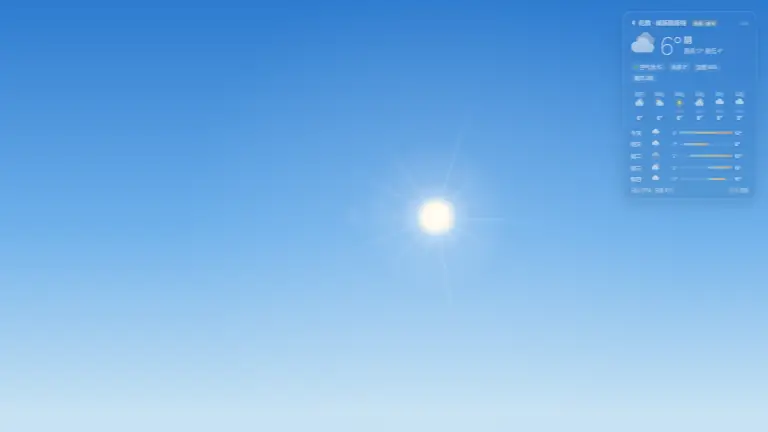
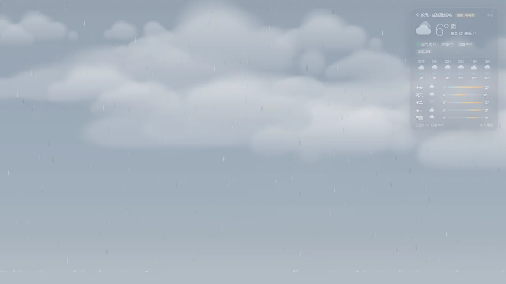
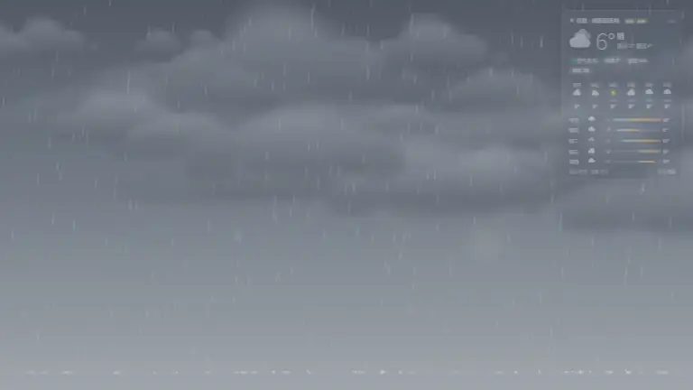
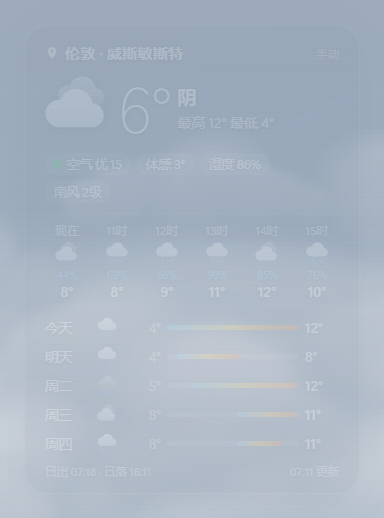

# 天气壁纸 Weather Wallpaper

Windows 11 动态天气桌面：按当前定位和当地时间实时渲染天空和天气，桌面上显示一张半透明天气卡片。下雨时雨点还会砸在任务栏和窗口顶边上。

<p align="center"><br><sub>一天快进演示（48 秒走完日出 → 正午 → 日落 → 夜晚）</sub></p>

## 效果预览

| 晴天 | 多云 |
|:---:|:---:|
|  |  |
| **日落** | **晴夜** |
|  |  |
| **毛毛雨** | **暴雨** |
|  |  |
| **雷阵雨** | **雪** |
|  |  |

<p align="center"><br><sub>天气卡片（100% 缩放下的原尺寸截图）</sub></p>

> 动图按 1280×720 录制（点开可看大图），实际是全屏、按显示器分辨率渲染。所有天气都可以在托盘菜单「效果预览」里随时看。

## 功能

- **天空**：太阳的位置和颜色按当地日出日落实时计算（晨昏的橙红、正午的白亮），夜晚有星空和真实月相：月亮按农历日子东升西落（初三四傍晚西边一弯新月、十五六整夜一轮满月），亮面朝向太阳，细月牙时还能看到暗面的地照。
- **天气**：晴、多云、阴、雾、毛毛雨、中雨、暴雨、雷阵雨（带闪电）、雪。云量、风向、风速都来自实时数据。雨停转晴的白天，背对太阳的一侧会挂出一道彩虹（默认 30 秒，每场雨一次）。
- **节日装饰**：按天气所在城市的当地日期，到了节日桌面上自动换上应景的装饰（农历节日按香港天文台的官方历表，不会差一天）：
  - 春节（除夕到初七）：两盏写着"福"字的大红灯笼，每晚放烟花，除夕零点前后最密；元宵节：一串彩色花灯，晚上放烟花。
  - 端午节：一盘粽子、一捆扎着红绳的艾草；中秋节：一对橘黄灯笼、一盘月饼和一只红眼睛的玉兔；国庆节（1–7 日）：屏幕正中一根高旗杆，五星红旗在屏幕中上方迎风飘扬（10 月 1 日当天第一次开机 / 解锁时，旗子从杆底缓缓升上去，到顶迎一阵大风），10 月 1 日晚上放烟花；跨年夜：零点前后放烟花。
  - 万圣节：南瓜灯（夜里里面的烛光一闪一闪，还飘着个小幽灵），时不时飞过一群蝙蝠；圣诞节（平安夜和圣诞节）：挂满彩灯的圣诞树和礼物，夜里圣诞老人的驯鹿雪橇从月亮前面飞过，下雪时雪人堆得快得多；复活节：草丛里的彩蛋和一只兔子。
  - 装饰都会避开卡片；下雨、打雷的夜里不放烟花。
- **彩蛋**：雪下得够久（约 5、11、17 分钟），地上的雪地会慢慢铺厚，悄悄堆起几个戴围巾的小雪人——雪停后它们还会留一阵子，消融完了才化掉。晴朗的夜里，偶尔有一颗流星划过星空。节日装饰和彩蛋可以在托盘「效果设置」里一起关掉。
- **自定义效果**：自己写一小段 JavaScript，让特定的日子（比如自己或家人的生日、纪念日，公历农历都行）桌面上出现专属的效果——气球、蛋糕、祝福语、烟花……自带一个生日示例，照着改就行（见下面的「[自定义效果](#自定义效果)」）。
- **极简模式**（默认关）：平时桌面就是你自己的系统壁纸 + 天气卡片，天气画面完全不画；只在值得注意的时候整屏播放一小段天气动画（默认 30 秒，`PlaySeconds` 可调）再淡出——启动时、转雨 / 暴雨 / 雷雨、下雪、雨后转晴（彩虹）。桌面被窗口挡住、锁屏或人不在电脑前时先记下，等桌面露出来、有人操作时再看是否还需要播（雨已经停了就不播了）。
- **壁纸叠加**（默认关）：保留你原来的系统壁纸当底，天空那层半透明（默认 45%），云、太阳、月亮、雨雪照常实心浮在壁纸上——能看到壁纸的同时也能看到天气变化。天空和云的不透明度可以调（`SkyOpacity` / `CloudAlpha`）。和极简模式互斥（打开一个就关掉另一个）。占用和普通模式基本持平（实测同一场景下 CPU 相同、内存和显存反而略低 1–3%），不省电，想要省电请用极简模式。
- **天气卡片**：城市、温度、最高/最低、体感、湿度、风力、空气质量（中国 AQI 标准）、逐小时预报和 5 天预报。
  - **卡片内容可选**：除了城市和当前天气，其余各项都能单独开关，还可以加一行日期（公历、星期、农历，按卡片城市的当地日期）。「大卡片 / 中卡片 / 小卡片」一键切换：大卡片全显示，中卡片去掉未来几天，小卡片只留城市、当前天气和指标。卡片高度跟着显示的内容变（1080p 上大卡片约 446 像素高，小卡片 166）；定位方式和日出日落都不显示时，更新时间挪到城市那一行的右边，再省一行。
  - **多张卡片**（最多 8 张）：每张可以是不同城市（自动定位或指定城市），放在任意一块屏上，位置可选左上、顶部居中、右上、左下、底部居中、右下，偏移可调；同一块屏上的卡片自动排开、不重叠，放不下就不让放。
  - 天气画面跟着天气卡片走：放了天气卡片的屏才显示天气壁纸，没有卡片、或者只放了自定义卡片的屏保持系统壁纸。每块屏的全屏天气跟随其中一张卡片的城市（预览图上带云朵标记的那张）。
  - 只想要天气画面、不想要卡片：把卡片设成「只显示天气画面，不显示卡片」，它不在桌面上显示，只决定这块屏的天气城市。
  - 暂时不想看某张卡片：点「隐藏卡片」收起来（不用删除），它不显示、不占位置、不更新天气，也不决定天气画面；想要时点「显示卡片」恢复，天气随即更新。默认卡片不能隐藏。
  - 在预览图上拖动卡片时，靠近其他卡片的边或中线、挨着其他卡片、贴近屏幕默认边距或水平中线会出现对齐线并自动吸附（按住 Ctrl 或 Alt 不吸附）。
  - 卡片都隐藏了也能随时看天气：**左键点托盘图标**弹出天气面板（类似 Windows 快捷设置面板，点别处自动收起）。
- **自定义卡片**：卡片的内容也可以自己写——时钟、倒计时、每日一句、自己关心的网上数据……一个 `.js` 文件就是一种卡片，和天气卡片一样摆放、对齐。自带时钟、倒计时、每日一句三个示例（见下面的「[自定义卡片](#自定义卡片)」）。
- **任务栏**：下雨时雨点砸在任务栏上沿，溅起水花、留下涟漪；下雪时任务栏上积雪。配色跟随系统深色/浅色主题。
- **窗口屋檐**：大小适中的普通窗口顶边也会被雨打出水花、积起薄雪（最大化和全屏窗口不算）。拖动或最小化窗口时，积雪会被抖掉。
- **多显示器**：天气卡片放在哪块屏，哪块屏就有天气画面；每块屏可以显示不同城市的天气。
- **自动更新**：启动时和之后每 12 小时检查一次新版本（电脑睡眠过也按实际时间算）。不弹通知打扰，只在托盘右键菜单、左键弹出面板和「关于」里提示；点一下自动下载并更新（安装版和便携版都支持），完成后自动重启。国内网络优先走加速地址。也可以在右键菜单「关于」里手动检查、关掉自动检查。

## 性能

后台常驻的壁纸程序，最在意的就是占用。实测（Windows 11，16 线程 CPU，1920×1080，默认 30 FPS）：

| 场景 | CPU（占整机） | 内存（私有工作集） |
|---|---|---|
| 晴天 / 多云 / 阴天 | 约 1–3%（0.15–0.45 核） | 约 240 MB |
| 暴雨 + 任务栏 + 窗口屋檐 | 约 5–6%（≈0.9 核） | 约 270 MB |
| 桌面被窗口挡住 / 锁屏 / 全屏游戏或视频 | ≈0（暂停） | 不变 |
| 极简模式（平时） | ≈0（0.01 核，GPU 0%） | 约 200 MB |
| 壁纸叠加（雨天） | 约 2%（0.35 核）；被遮挡时 ≈0 | 约 380–430 MB，显存比普通模式略低 |

CPU 按桌面完全露出时测的；桌面被其它窗口大面积遮挡时会自动降帧，实际更低。

内存里约 **120 MB 是 WebView2（Edge 内核）的固定开销**（浏览器、GPU、网络等进程，空白页也要这么多），程序本体约 20 MB，托盘弹出面板常驻约 15 MB（为了点开即显示），其余是画面渲染。在意占用就开**极简模式**：平时天气画面整层释放，只剩一张预先缩放好的系统壁纸和卡片，CPU / GPU 基本为 0。`settings.json` 里还有个 `LowMemory`（省内存，默认关）：渐变复用并量化颜色，弹出面板用时再建、收起 1 分钟后释放，代价是暗色天空下半部可能出现极淡的横向色带、面板每次打开要等约 1 秒。

省电措施：

- 桌面露出的部分少于 35% 时降到 15 FPS，几乎全被挡住时暂停。
- 锁屏、全屏游戏或全屏视频时暂停。极简模式和壁纸叠加同样适用（暂停是宿主对每块屏的壁纸窗口统一下发的，和模式无关）。
- 用电池或系统繁忙（CPU > 80% 或内存 ≥ 92%）时自动降帧。
- 天空只在肉眼看得出变化时才重画（晴天白天一分钟只画几次，星星闪烁、日芒转动按 0.3–0.5 秒一档）；没有星月和清晰太阳的柔和画面（阴天、雨雪、雾）自动用半分辨率。
- 云单独一层、固定半分辨率、最多 12 FPS，没有云时整层停掉；雨天压暗和雾霾用 CSS 渐变叠加，不占画布。
- 降水层只在有雨雪时才分配和绘制；没有降水时不跑 60 Hz 动画循环，改为按需定时唤醒。
- 「高帧率（60 FPS）」默认关闭；觉得占用高可以关掉任务栏效果和窗口屋檐。

## 安装

从 [Releases](../../releases) 下载：

- `WeatherWallpaper-x.y.z-x64.msi`：安装包。按当前用户安装，不需要管理员权限，装完自动启动。
- `WeatherWallpaper-x.y.z-x64-portable.zip`：便携版。解压后运行 `WeatherWallpaper.exe` 即可。

访问 GitHub 不方便时可以用加速地址：<https://gh.ifly.qzz.io/WeatherWallpaper/releases/latest>

需要 Windows 10/11 x64 和 WebView2 运行时（Windows 11 自带）。退出程序后会恢复原来的系统壁纸。

deepin 25（treeland）另有一个版本：Releases 里的 `wwp-weather-wallpaper_x.y.z_arm64.deb` / `_amd64.deb`，
`sudo apt install ./wwp-weather-wallpaper_*.deb` 装好后在控制中心 → 个性化 → 壁纸 → 动态壁纸里选“天气壁纸”，
启动器里的“天气壁纸设置”可调底层壁纸、卡片位置和内容。说明和源码见 [deepin-v25/](deepin-v25/README.md)。

## 使用

- **左键**托盘图标：弹出天气面板（刷新天气、卡片设置、更多设置）。程序已在运行时，再从开始菜单打开一次也会弹出这个面板。
- **右键**托盘图标：全部设置——
  - 立即刷新天气。
  - 效果设置：任务栏雨雪效果、窗口顶边雨滴 / 积雪（屋檐）、节日效果、高帧率（60 FPS），以及当前帧率 / 暂停原因。
  - 效果预览：可以选任意天气，「节日」子菜单里可以看各个节日的装饰（不管节日效果开没开），「自定义效果」子菜单里可以看自己写的效果、打开效果文件夹；「一天快进演示」按所选天气用 48 秒走完一天。天气预览播放 `PlaySeconds` 秒（与极简模式每次播放的时长相同，默认 30 秒）后自动恢复实时天气。极简模式下第一项变成「当前天气」，点一下按实时天气播放一次。
  - 极简模式（普通模式的另一个变体，见「功能」）。
  - 壁纸叠加（保留系统壁纸，天气半透明地浮在上面）。
  - 普通模式 / 壁纸叠加 / 极简模式三种状态可以任意直接切换：勾选哪个就切到哪个（打开一个自动关掉另一个），取消勾选回到普通模式。
  - 开机自启。
  - 卡片设置…（新增、切换、隐藏、删除卡片都在这个窗口里：顶部页签切换卡片，卡片多了可以左右滚动；左边是名称、城市、所在屏和卡片内容，右边是位置预览和天气画面）。卡片设置改动实时生效、自动保存，没有保存按钮；摆放不下的位置（或卡片显示的内容多了、变高后放不下）会标红、不保存，换卡片或关窗口时还原。
  - 发现新版本时多出一项「发现新版本…，点击更新」。
  - 关于：版本号、GitHub 项目地址、更新日志、问题反馈；检查更新、自动检查更新开关；打开设置文件、日志目录、自定义效果和自定义卡片文件夹。

### 设置文件

位于 `%APPDATA%\WeatherWallpaper\settings.json`。右键菜单「关于」→「设置文件」会直接用记事本打开它，保存后立即生效。文件里每个字段上方都有一行 `"// 字段名"` 说明怎么写，常用项：

| 项 | 写法 | 默认 |
|---|---|---|
| `Cards` | 桌面卡片列表（建议用托盘菜单「卡片设置…」改）。每张：`Screen` 所在屏（`primary` 主屏，或设备名如 `\\.\DISPLAY2`）、`Pos` 位置（`tl` `tc` `tr` `bl` `bc` `br`）、`OffsetX` / `OffsetY` 离边缘的像素（按 100% 缩放计，底部位置从任务栏算起）、`City` / `Lat` / `Lon`（都为 `null` = 自动定位）、`Name`、`Scene`（这块屏的全屏天气跟随它）、`Hidden`（不画卡片、只显示天气画面）、`Off`（隐藏这张卡片：不显示、不占位置、不更新天气，改回 `false` 恢复）、`Show`（卡片上显示哪些内容，逗号分隔：`date` 公历、`week` 星期、`lunar` 农历、`hilo` 最高最低温、`src` 定位方式、`aqi` 空气、`feel` 体感、`hum` 湿度、`wind` 风力、`hours` 逐小时、`days` 未来几天、`sun` 日出日落、`upd` 更新时间；`""` = 只显示城市和当前天气）、`Script`（自定义卡片用的脚本：cards 文件夹里的文件名，不带 `.js`；`null` = 天气卡片）、`Height`（自定义卡片的高度，`64`–`720` 像素；天气卡片的高度按显示的内容自动算，不用写）。第一张是默认卡片，不能删除、不能隐藏，只能是天气卡片 | 一张自动定位的卡片 |
| `Fps` | `30` 或 `60` | `30` |
| `TaskbarFx` / `WindowFx` / `ShowPanel` | 任务栏效果 / 窗口屋檐 / 桌面卡片：`true` 或 `false` | `true` |
| `Festive` | 节日装饰与彩蛋（灯笼、烟花、圣诞树、雪人、流星…）：`true` 或 `false` | `true` |
| `Minimal` | 极简模式：`true` 或 `false`（见「功能」） | `false` |
| `OverlayWall` | 壁纸叠加：`true` 或 `false`（见「功能」）。和 `Minimal` 互斥 | `false` |
| `SkyOpacity` | 壁纸叠加时天空那层的不透明度，`0.05`–`1` 的小数，越小壁纸越清楚 | `0.45` |
| `CloudAlpha` | 壁纸叠加时云的不透明度，`0.1`–`1` 的小数，越小云越透 | `0.72` |
| `PlaySeconds` | 每次播放天气动画的秒数：极简模式的天气变化播放、雨后彩虹、托盘「效果预览」共用，`5`–`3600` 的整数；写错或超出范围按默认值 | `30` |
| `LowMemory` | 省内存：`true` 或 `false`（见「性能」） | `false` |
| `AutoUpdate` | 自动检查更新：`true` 或 `false` | `true` |

写错格式时这次修改会被忽略，程序继续用原来的设置。

### 命令行

转发给运行中的实例：

```
WeatherWallpaper.exe preview heavy        # 预览暴雨（clear sunrise sunset night partly cloudy fog drizzle rain heavy thunder snow rainbow）
WeatherWallpaper.exe preview clear day    # 晴天的一天快进
WeatherWallpaper.exe preview xmas         # 预览节日（cny lantern dragon midautumn national newyear halloween xmas easter）
WeatherWallpaper.exe preview user:生日示例  # 预览自定义效果（user: 加效果文件名，不带 .js）
WeatherWallpaper.exe preview live         # 恢复实时
WeatherWallpaper.exe festive on|off       # 节日装饰与彩蛋开关（不带参数 = 切换）
WeatherWallpaper.exe fx rain              # 极简模式下立即播放一次（start rain heavy thunder snow rainbow；off 停止）
WeatherWallpaper.exe fx rain <卡片Id>     # 只播这张卡片的城市（卡片 Id 见 settings.json；这个城市不是任何屏的画面城市时跳过）
WeatherWallpaper.exe overlay on|off      # 壁纸叠加开关（测试 / 脚本用，等同托盘菜单那一项）
WeatherWallpaper.exe overlay 0.35 0.6    # 边调边看：天空不透明度 [云不透明度]，写入设置并立即生效
WeatherWallpaper.exe card                 # 打开卡片设置（card new：打开并新增一张卡片）
WeatherWallpaper.exe about                # 打开「关于」（版本、检查更新）
WeatherWallpaper.exe refresh | flyout | checkupdate | quit
```

### 自定义效果

想在家人生日那天给桌面加点惊喜：效果文件夹 `%APPDATA%\WeatherWallpaper\effects\` 里的每个 `.js` 文件就是一个效果（右键托盘 →「效果预览」→「自定义效果」→「打开效果文件夹」，或「关于」→「自定义效果」）。第一次运行时里面会放一个 `生日示例.js`：气球、蛋糕和蜡烛、一行跳动的「生日快乐！」、彩纸，夜里放几发烟花（没改过的话，程序升级时会自动换成新版的）。

1. 把 `生日示例.js` 复制一份，改个名字（比如 `妈妈生日.js`）。
2. 用记事本或 VS Code 打开，把 `WHO` 改成称呼，`dates` 改成日子，保存。
3. 托盘「效果预览」→「自定义效果」里点它的名字马上就能看到效果；保存后壁纸会自动重新加载，不用重启程序。

不想要了就删掉文件，或者把扩展名改成别的（如 `.js.off`）。

```js
WeatherWallpaper.effect({
  name: '妈妈生日',
  dates: ['03-15', 'lunar:08-15'],   // 每年公历 3 月 15 日、每年农历八月十五（也可写 '农历08-15'）；'2027-01-01' 只那一天
  // when: d => d.weekday === 5 && d.hour >= 18,   // 更灵活的判断（每周五晚上）
  fireworks: 1,                      // 当天夜里放烟花：0 不放 / 1 隔一阵放一发 / 2 很密
  preview: { time: 'night' },        // 托盘预览时的时间和天气
  draw(ctx, fx) {                    // 每帧调一次：ctx 是 Canvas 2D，画布每帧已经清空
    ctx.font = `bold ${72 * fx.k}px "Microsoft YaHei"`;
    ctx.fillStyle = '#ff6b8b';
    ctx.textAlign = 'center';
    ctx.fillText('妈妈生日快乐！', fx.free(fx.W / 2, 600 * fx.k, fx.H * 0.25, fx.H * 0.35), fx.H * 0.3);
  },
});
```

- 日子按天气所在城市的当地日期算；农历按内置的 1900–2100 年农历表换算（和香港天文台的历表一致，卡片上的农历日期也用它），闰月不算。
- `draw` 拿到的 `fx`：屏幕大小 `W` / `H`、缩放系数 `k`（按 1080p 设计的尺寸乘上它）、地平线 `ground`、出现了多少秒 `t`、距上一帧 `dt`、夜色 `night`（0 白天 … 1 深夜）、天气 `weather`（`rain` `snow` `cloud` `fog` `thunder` `wind`）、日期 `date`、卡片位置 `cards`，以及几个帮手：`free()` 找一个不被卡片挡住的位置、`glow()` 柔光、`shade()` 跟着夜色变暗的颜色、`firework()` 放一发烟花、`state` 存自己的数据。完整说明写在 `生日示例.js` 的开头。
- 效果画在天气卡片和雨雪下面，不受「节日装饰与彩蛋」开关影响。帧率默认 30（`fps: 15` 更省电）。
- 脚本出错只会停掉这个效果，不影响壁纸；出错信息写在 `%LOCALAPPDATA%\WeatherWallpaper\log.txt`（搜 `effect`）。

### 自定义卡片

桌面卡片的内容也可以自己写：卡片文件夹 `%APPDATA%\WeatherWallpaper\cards\` 里的每个 `.js` 文件就是一种卡片（「卡片设置…」→「＋ 新增卡片」→「打开 cards 文件夹」，或「关于」→「自定义卡片」）。第一次用时里面会放三个示例：

- `时钟天气示例.js`：大字时间、公历 / 星期 / 农历，下面一行默认卡片城市的天气和空气。开头有完整的写法说明（`api` 都有什么、有哪些规矩），写自己的卡片之前先看它。
- `倒计时示例.js`：离春节、元旦、国庆还有几天（公历、农历日子都能写），改 `DAYS` 换成自己的日子。
- `每日一句示例.js`：每天换一句话。先读文件夹里的 `每日一句.txt`（自己建，一行一句），没有就从网上的「一言」取，没联网用内置的几句；不喜欢今天这句，在卡片设置里点「换一句」——演示读文件、联网、兜底和刷新按钮；卡片高度按句子长短自动调整（`autoHeight`）。

示例没改过的话，程序升级时会自动换成新版的；改过的不会动（想对照新版：程序安装目录下的 `web\cards\` 里是最新的示例，文件名是英文的）。

用法：

1. 把一个示例复制一份、改个名字（比如 `我的卡片.js`），改里面的 `render`。
2. 「卡片设置…」→「＋ 新增卡片」，在「自定义卡片」下面选它；同一种卡片可以加好几张。位置、所在屏和天气卡片一样调，高度在「自定义卡片」那一栏里调；内容长短不定的卡片（比如每日一句）可以在脚本里写 `autoHeight: true`，高度就跟着内容走（每次画完按内容的实际高度调整，64–720；「自定义卡片」那一栏里的高度变成灰的、显示量出来的值；`height` 只是还没画出来时先用的高度；要直接写成 `true`，不能是变量；内容不要写成「铺满」，比如 `height: 100%`）。
3. 改了脚本保存后，桌面上马上更新，不用重启程序。不想要了就删掉卡片，或者把文件删掉 / 扩展名改成别的（如 `.js.off`）。
4. 联网的卡片在「自定义卡片」那一栏里有个「立即刷新」按钮：不等 `refresh`，马上重画一次、重新联网取数据。按钮上的字可以用 `refreshButton: '换一句'` 改（最多 12 个字），`refreshButton: false` 不要按钮（不联网的卡片写 `refreshButton: true` 或按钮上的字也有）；脚本里 `api.manual` 为 `true` 说明这一次是点按钮画的。

```js
WeatherWallpaper.card({
  name: '离发工资',          // 新增卡片时的默认名字
  height: 96,                // 新增卡片时的默认高度（64–720，宽固定 336）
  refresh: 3600,             // 多少秒重画一次，按本地时间对齐：60 每分钟整、3600 每小时整、86400 每天零点
  style: `.n { font-size: 40px; font-weight: 600; }`,
  async data(api) {          // 可选：准备数据（联网、读文件都在这里）
    const now = api.date();
    const pay = new Date(now.year, now.month - 1 + (now.day > 15 ? 1 : 0), 15);
    return api.daysUntil(pay.getTime());
  },
  render(left, api) {        // 返回卡片的 HTML
    return `离发工资还有 <span class="n">${left}</span> 天`;
  },
});
```

`api` 提供：`now` 这次重画的时间；`manual` 这次是不是点了刷新按钮；`date(t)` 年月日时分、星期、农历；`daysUntil(t)` 离某天还有几天；`nextLunar(月, 日)` 下一个农历某月某日；`weather` 默认卡片城市的天气（温度、体感、湿度、风、空气、日出日落、接下来 24 小时、未来几天）；`icon(kind, isDay)` 和天气卡片一样的天气图标；`esc(文字)` 转成能放进 HTML 的文字；`card` 卡片里面能画的大小；`fetchJson` / `fetchText` / `fetchImage` 联网；`readText` / `readJson` / `image` 读 cards 文件夹里的文件。每一项的具体写法见 `时钟天气示例.js` 的开头。

规矩（犯了的话卡片会藏起来，原因在卡片设置里能看到）：

- **只能看、不能点**：卡片不接收鼠标，HTML 里不能有链接、按钮、输入框，`<script>`、`onclick` 不会运行。
- **不能一直动**：CSS 动画（`animation` / `@keyframes`）、动图、`<marquee>`、SVG 动画都不行；要变的内容靠 `refresh` 重画（最少 1 秒，建议 60 秒以上）。桌面被窗口挡住时最多一分钟重画一次。
- **联网只能用 `api.fetchJson` / `fetchText` / `fetchImage`**（GET 或 POST）：只能访问互联网上的网站，本机和局域网里的地址（`localhost`、`192.168.x.x` 这些，跳转过去的也算）不行；内容最大 1 MB、15 秒超时；同一个请求 60 秒内只真的发一次（再要就给上次的结果；点了刷新按钮的那一次除外）；每张卡片每分钟最多 10 个不同的请求（同一个请求一分钟里只算一次）；不保存 Cookie（要用就自己写在 `headers` 里；跳转到别的网站时不再带 `Authorization` 和 `Cookie`）；`headers` 的值不能有中文和换行（要带中文先用 `encodeURIComponent` 转一下）。
- **只能读 cards 文件夹里的文件**（可以带子文件夹，但不能经过符号链接、目录联接读到别处），每个最大 256 KB；脚本本身也不能超过 256 KB。
- **图片只能用 `data:` 网址**（`api.image` / `api.fetchImage` 给的）；CSS 里不能用 `url()` 引用外部文件，也不能 `@import`、`@font-face`（系统装了的字体可以直接写在 `font-family` 里）。
- `render` 要在 2 秒内返回，`data` 最多 40 秒；读文件、联网合起来每分钟最多 600 次（在循环里一直要数据的会被结束）；脚本里没有 `setTimeout`、`fetch`、`document` 这些。
- 自定义卡片和天气卡片一共最多 8 张；它不取天气、不带天气画面（只放了自定义卡片的屏保持系统壁纸）。

出错了怎么办：

- 脚本有语法错误、运行出错、返回了不允许的 HTML、`render` 卡住、联网 / 读文件失败没接住……卡片都会先藏起来（位置留着，桌面上别的卡片不会跟着挪），改好保存后自动重新显示；联网之类的临时问题过一会儿（约 1 分钟）自动重试，好了就出来。
- 出错原因（哪个文件、第几行、什么错）在「卡片设置…」里那张卡片的「自定义卡片」一栏里能看到，也写在 `%LOCALAPPDATA%\WeatherWallpaper\log.txt` 里（搜 `card`）。

安全上，卡片脚本跑在单独的后台线程里：没有网页的 DOM、断网、不能开定时器，卡住了会被直接结束；画出来的 HTML 经过白名单过滤，显示在不能运行脚本、不能加载外部资源的隔离框里。脚本只能通过 `api` 联网和读 cards 文件夹，碰不到你电脑上的其他文件。不过它毕竟是代码：只放自己写的、或者看得懂的脚本；网上拿来的文字放进 HTML 之前一定要用 `api.esc` 转一下。

## 常见问题

- **桌面图标还在吗？** 在。壁纸画在桌面图标后面，图标、右键菜单都不受影响。
- **托盘图标找不到？** Windows 11 会把新程序的托盘图标默认收进任务栏的「^」里。本程序首次运行时会自动把自己设为显示；如果你之后手动隐藏过，可以在「设置 → 个性化 → 任务栏 → 其他系统托盘图标」里打开「天气壁纸」。也可以从开始菜单再打开一次，会直接弹出天气面板。
- **定位不准？** 右键托盘 →「卡片设置…」→「指定城市」手动指定，区、县、镇和景区（如「汉南区」「婺源」「神农架」）都能搜到；Windows 定位服务关闭时会退回 IP 定位，可能只精确到城市。外国城市搜中文名找不到时，用英文名（如 Seoul）。
- **从 0.2 升级后多了几张卡片？** 旧版的「显示在：全部显示器」会自动转成主屏一张卡片、其他屏各一张只显示天气画面的卡片（桌面上看不到），看到的和以前一样（升级时没接上的屏不会自动加，接上后在「卡片设置…」里新增一张放过去）；不想要哪块屏的天气，在「卡片设置…」里删掉或隐藏那块屏的这张卡片即可。旧版选了某一块屏的，卡片会放到那块屏上（升级时那块屏没接上就留在主屏，接上后在「卡片设置…」里换过去）。旧版关掉了「显示天气卡片」的，卡片会变成只显示天气画面，想显示哪张就在「卡片设置…」里取消勾选「只显示天气画面」。
- **和 Wallpaper Engine 等壁纸软件冲突吗？** 会互相覆盖，同时只开一个。
- **怎么彻底卸载？** 安装版在「设置 → 应用」里卸载（会去掉开机自启）；便携版退出后删除文件夹，再删掉 `%APPDATA%\WeatherWallpaper` 和 `%LOCALAPPDATA%\WeatherWallpaper`。

## 数据来源

- 定位：Windows 定位服务，失败时用 IP 定位（ip-api.com）。
- 地名：BigDataCloud 反向地理编码；城市搜索用 [Photon](https://photon.komoot.io/)（© [OpenStreetMap](https://www.openstreetmap.org/copyright) 贡献者）和 [Open-Meteo 地理编码](https://open-meteo.com/en/docs/geocoding-api)（GeoNames）。
- 天气和空气质量：[Open-Meteo](https://open-meteo.com/)。

## 构建

需要 Visual Studio 2022（用它自带的 Roslyn `csc`）和 .NET Framework 4.8。

```powershell
.\build.ps1                         # -> bin\WeatherWallpaper.exe
.\build.ps1 -Version 1.2.3 -Msi     # 另外生成 dist\ 下的 MSI 和 zip（需要：dotnet tool install -g wix --version 5.0.2）
```

发布一个 GitHub Release（tag 形如 `v1.2.3`）后，Actions 会自动构建 MSI 和便携版 zip，并上传到这个 Release。README 里的动图用 `tools/readme`（puppeteer + ffmpeg）录制；程序图标 `app.ico` 由 `tools/make-icon.ps1` 生成。
